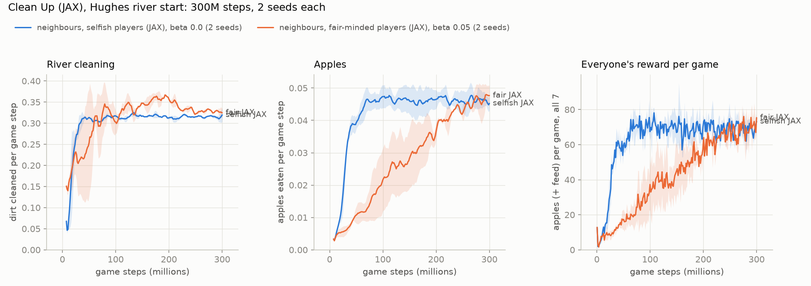

# Melting Pot

[DeepMind's Melting Pot](https://github.com/google-deepmind/meltingpot) (`dm-meltingpot` 2.4.1,
Apache 2.0) is a set of small multiplayer games built around social dilemmas, plus pretrained bot
populations to play them with. Each **scenario** puts the agents you're testing in a game with
bots they've never met, so it measures whether they can get along with strangers.

## What it gives us

- 24 games in 49 versions, and about 312 test scenarios.
- Pretrained bots (cooperative, selfish, and others).
- People can play the games themselves, alongside bots (`meltingpot/human_players`).
- We can build our own games (Python settings plus Lua game logic).

What it doesn't have: models of human behaviour, or any game about platforms or companies. Those we
build or bring.

## The games

| Family | Game (versions) | What happens |
|---|---|---|
| Sharing a resource | Commons Harvest (3) | Apples regrow only near other apples. Take the last one and the patch dies |
| | Clean Up | Apples grow only while someone cleans a polluted river, which pays the cleaner nothing |
| | Externality Mushrooms (2) | Some mushrooms reward the eater and cost everyone else |
| | Allelopathic Harvest (2) | Replant berries in your favourite colour; the most common colour grows fastest |
| | Factory of the Commons (2) | Shared factory machines turn raw materials into food |
| | Chemistry (4) | Two self-running reaction cycles stay alive only if players bring their by-products together |
| Teamwork | Collaborative Cooking (8 kitchens) | Overcooked: two cooks make soup, the classic human-AI teamwork test |
| | Coop Mining | Gold only comes out if two miners hit it at the same moment |
| | Boat Race (2) | A boat needs two rowers in sync |
| | Daycare | One player has to help another get food it can't reach alone |
| Trade and trust | Fruit Market (2) | Apple and banana farmers trade so each can eat what they like |
| | Gift Refinements | A refined item turns into three and can be given away |
| | Coins | Grabbing coins of another player's colour hurts that player |
| | "In the Matrix" (7 games, 17 versions) | Classic game theory as rooms: Prisoner's Dilemma, Stag Hunt, Chicken, Bach or Stravinsky, Pure Coordination, Rationalizable Coordination, Running with Scissors |
| Conflict and deception | Territory (4) | Claim ground by painting it; you can break other players' walls |
| | Paintball (2) | Capture the flag, king of the hill |
| | Predator Prey (5) | Prey survive by working together |
| | Hidden Agenda | Crewmates against a hidden impostor, with a vote to throw someone out |

Closest to our questions: Commons Harvest (squeezing until collapse), Clean Up (paying to heal),
Externality Mushrooms (profit that dumps costs on others), Hidden Agenda (a helper secretly working
for someone else), Fruit Market (a real market), Collaborative Cooking and Daycare (people and AI
working together).

## Running it on Windows (WSL2)

- Melting Pot's engine, **dmlab2d**, ships only for Linux and macOS (PyPI wheels; its README says
  the build rules are Linux and macOS only). No native Windows.
- So we run it in **WSL2**. This PC (Ryzen 5 5600, ASUS ROG STRIX B550-F) has virtualization
  turned off, so first: restart, **Del** into the BIOS, **F7** Advanced Mode, **Advanced > CPU
  Configuration > SVM Mode > Enabled**, **F10** to save. Then in an admin PowerShell:
  `wsl --install --no-distribution` and restart. On this PC's Windows build (26300) that command
  only printed "not installed", so on 2026-11-16 we did it in two steps instead:
  `dism /online /enable-feature /featurename:Microsoft-Windows-Subsystem-Linux /all /norestart`,
  the same for `VirtualMachinePlatform`, then `winget install --id Microsoft.WSL` (3.0.5), then a
  restart.
- **Linux goes on C:.** After the restart: `wsl --install -d Ubuntu-24.04`.
- WSL2 turns on Windows' hypervisor at boot. If games feel different afterwards, the hypervisor
  can be switched off for gaming with `bcdedit /set hypervisorlaunchtype off` plus a restart
  (`auto` to turn it back on).
- Installing Melting Pot downloads about **1.2 GB** (472 MB of game assets and bots, plus
  TensorFlow).
- WSL2 also gives us the RTX 4070 Ti for training, and play windows that open on the Windows
  desktop.

### What's installed (2026-11-16)

- Ubuntu 24.04 on C:, WSL 3.0.5. `wsl --install -d Ubuntu-24.04 --no-launch`, then open it once
  to pick a username and password.
- uv in Ubuntu, and a venv at `~/venvs/meltingpot` (inside Linux, not on `/mnt/c`, because it's
  much faster there): Python 3.12, `dm-meltingpot` 2.4.1, dmlab2d 1.0.2, TensorFlow 2.21. The
  install took under 2 minutes.
- GPU: `tensorflow[and-cuda]==2.21.0` (2.8 GB of NVIDIA libraries). TensorFlow missed
  `libcusolver.so.11` until `LD_LIBRARY_PATH` listed the venv's `nvidia/*/lib` folders; that's now
  set in Ubuntu's `~/.profile`, so always go through a login shell (`bash -l`). It then sees the
  RTX 4070 Ti.
- Calling it from Windows: use `wsl -d Ubuntu-24.04 -e bash -lc '...'`. Without `-e`, Linux's
  shell re-reads the command and breaks on `$PATH` (Windows paths with `(x86)` in them).
- Check that passed: Clean Up with 7 players ran 200 steps in 0.1 s, and scenario `clean_up_0`
  (3 of our players among DeepMind's trained bots) ran 200 steps in 2.3 s. The absl
  "unexpected argument" warnings it prints are noise.
- Clean Up already gives each player `NUM_OTHERS_WHO_CLEANED_THIS_STEP`. Experiment 1 leaves it
  out: it's a count, not who, and "seeing who's been cleaning" is what the towns vary.

### Playing it yourself

`wsl -d Ubuntu-24.04 -e bash -lc '~/venvs/meltingpot/bin/python -m meltingpot.human_players.play_clean_up'`

Keys: **WASD** move, **Q / E** turn, **1** zap, **2** clean the river, **Tab** switch to another
player. The other players stand still. No bots in this mode; playing alongside bots is something
we'd build.

### Training our own players (experiment 1, 2026-11-16)

Code in `sims/town/`: `envs.py` (many games in worker processes), `ppo.py` (each player has its
own network; fairness reward from Hughes et al. 2018), `train.py`, `report.py`. Several runs share
one process:

```
wsl -d Ubuntu-24.04 -e bash -lc 'cd /mnt/c/dev/new-melting-pot && ~/venvs/meltingpot/bin/python sims/town/train.py --runs neighbours:selfish neighbours:fair --steps 1e7'
```

Ctrl-C saves checkpoints; `--resume` carries on (it refuses if the settings changed, and a new run
refuses a folder that already holds one). Tests: `~/venvs/meltingpot/bin/python -m pytest
sims/town/tests -q` (18 tests, about 2.5 minutes; the JAX version's 25 are in
`sims/jaxtown/tests`, about 3 minutes; `pytest sims` runs all 43 in about 6). The players only see their own view, shrunk to
22×22 (2×2 pixels per map cell), and whether their zap beam is ready. They don't get Clean Up's
`NUM_OTHERS_WHO_CLEANED_THIS_STEP` count, so the only way to know who cleaned is to see it.

`--river` sets how dirty the river starts. Apples only grow while under 40% of it is dirty.

- `melting_pot` (default): Clean Up as shipped, 79 of 147 river cells dirty (54%).
- `hughes`: just past the tipping point, as in Hughes et al. 2018, 60 of 147 (41%).
- `clean`: no dirt and none ever spawns, a sanity check that the players can learn at all.

Seven random players over 1,000 steps eat 0, 18 and 405 apples respectively. The first check run
(2026-11-16, 10M steps each, selfish vs fair, shipped river) barely learned: under 0.01 apples
per step in every update, and both groups alike. On the clean river the same learner went from 0.5 to 2.5 apples per step by 1.2M
steps. So the shipped start is too far past the tipping point for players learning from scratch to
ever find a reward.

Speed on this PC (Ryzen 5 5600, RTX 4070 Ti, WSL), learned the hard way:

- Importing OpenCV (`cv2`) in a process makes the Melting Pot game about 8× slower (1,800 →
  230 steps/s). The game workers never import it.
- Two JAX processes sharing the GPU under WSL take turns so badly that every step gets about
  30× slower. So one process trains several runs, and while one run's games step, it chooses
  the next run's actions.
- `jax.device_put` the inputs before calling a jitted function; passing numpy arrays straight in
  was about 10× slower here. Split random keys inside jit (outside, a split costs 1.5 ms).
- `meltingpot/__init__.py` loads TensorFlow for its bots; the game workers swap in empty
  `meltingpot.bot` / `meltingpot.scenario` modules first (1.0 → 0.7 GB per worker).
- Free-running game processes manage about 7,000 steps/s in total; in lockstep with the learner
  it's about 2,000-3,000 in total, because each step waits for the slowest worker.
- Never step a Clean Up game after its last step (`ts.last()`): the automatic reset crashes in
  Clean Up's dirt tracker. Reset it yourself.

The second check run (2026-11-17, `--river hughes`, 10M steps each) reproduced the paper's
direction: fair players cleaned about twice as much as selfish ones (323 vs 159 dirt per game).
It didn't reproduce the payoff: the river never got below the tipping point, so neither town ate
much. The paper and SocialJax train about 30× longer (around 300M steps). At ~1,000 steps/s per
run that would take 3½ days per run, which is why we built the JAX version below.

### Our JAX Clean Up (2026-11-17)

`sims/jaxtown/` runs Clean Up on the GPU, thousands of games at once. It's built from SocialJax's
Clean Up (ICLR 2026, Apache 2.0; a copy of 5 files at commit 18e2171 in
`third_party/socialjax/`, see its `SOURCE.md` and our `NOTICE`). It was rewritten so the rules
match Melting Pot's, read from Melting Pot's Lua and dmlab2d's `grid.cc`:

- movement relative to facing, with players moving in random order;
- Melting Pot's beam shape and blocking;
- the 50-frame zap timeout and recharge times;
- the dirt fraction over the 147 river cells;
- Melting Pot's random game length;
- each player's own apples;
- the four towns, as data, in `sims/town/spec.py`, which both versions read.

`cleanup.py`'s docstring has the details and the few known simplifications.

The one deliberate difference is what players see: an 11×11 grid (the same window as Melting
Pot's: 9 ahead, 1 behind, 5 to each side) of 0/1 channels per cell, instead of pixels. Each other
player has their own channel, except in the strangers town where everyone else is just "someone".
Others' facing isn't shown, because Melting Pot's players don't rotate.

How we know it matches (`sims/jaxtown/compare.py`, `out/jaxtown/compare.md`):

- **Beam:** with Melting Pot's own players zapping, 327 zaps hit exactly our beam's 9 cells.
- **Random play:** random players in every town and river start: 120 Melting Pot games against
  1,024 of ours each. All 80 comparisons agree within 10% or within the 95% ranges: game length,
  apples, cleaning, zaps and feed per step.
- **What the comparison caught along the way:**
  - In Melting Pot an apple that grows under a standing player is eaten at once. Players only
    turning on the spot ate 181 apples in 1,950 frames.
  - A feed tile's countdown starts in the frame you arrive.
- **Rule tests:** 21 hand-made-map tests in `sims/jaxtown/tests` cover beams, the timeout,
  recharges, moves and bumping, eating, growth, dirt, game length, the view, identity, the badge
  and the feed.

Training (`sims/jaxtown/train_jax.py`, same flags and output files as `sims/town/train.py`, so
`report.py` charts both):

```
wsl -d Ubuntu-24.04 -e bash -lc 'cd /mnt/c/dev/new-melting-pot && ~/venvs/meltingpot/bin/python sims/jaxtown/train_jax.py --runs neighbours:selfish neighbours:fair --river hughes --steps 1e7'
```

Speed:

| What | Steps per second |
|---|---|
| Random play, 1,024 games | ~630,000 (SocialJax's version) |
| Random play, 2,048 games | ~750,000 (ours) |
| Training, 512 games, bfloat16 (`--dtype`) | ~28,000 |
| Training, same, float32 | ~19,000 |
| Melting Pot trainer, per run | ~1,000 |

Learning, not playing, takes most of the time: per update, 0.4 s plays the games and 1.8 s
trains. The clean-river sanity run learns as on Melting Pot: apples per step 0.2 → 2.3 by 3M
steps, against 0.5 → 2.5. It's a little slower per step because each update averages over 512
games.

GPU memory under WSL:

- No single GPU allocation can reach 4 GiB (3.9 GiB works, 4.5 GiB fails, 3 × 3 GiB works).
- JAX's default memory pool grows in ever bigger blocks and then fails, so `train_jax.py` uses
  `XLA_PYTHON_CLIENT_ALLOCATOR=platform`.
- One compiled training step must also stay under that cap. At 512 games, 16 minibatches need
  2.85 GiB; 8 would need 4.86 GiB.

### Selfish vs fair, on to 300M steps (2026-11-17 to 11-18)

The test: in the neighbours town with the `hughes` river start, do fair-minded players (Hughes et
al.'s guilt, beta 0.05) clean more and eat more than selfish ones, as in the paper? A result only
counts if it holds across seeds, so we compare against the published work, not against one run.

**At 10M steps, 4 seeds each:** fair players cleaned more on average, 283 dirt per game (range
221-368), against 213 for selfish players (116-330). The ranges overlap, and the selfish players
ate more (14.8 against 9.6 apples per game, all seven together). Melting Pot's single check run
above (fair 323, selfish 159) sits inside those ranges, so the two versions agree within the
noise. Too early to call.

**At 300M steps, 2 seeds each** (four runs sharing the GPU, about 7,200 steps/s each, 11½ hours):



| Players | Seed | Dirt cleaned / step | Apples / step | Reward / game (all 7) | Cleaned / game |
|---|---|---|---|---|---|
| selfish | 0 | 0.323 | 0.049 | 72.8 | 484 |
| selfish | 1 | 0.309 | 0.044 | 65.1 | 462 |
| fair | 0 | 0.322 | 0.043 | 64.2 | 485 |
| fair | 1 | 0.333 | 0.051 | 76.2 | 497 |
| random players | | 0.348 | 0.008 | | |

Last 10% of each run; random players from `compare.md`. Games last about 1,500 steps.

- **No difference at the end.** Both groups clean about as much as random players and eat about
  70 apples per game between the seven of them. A clean river feeds them about 2.3 apples per
  *step*.
- **Guilt slowed learning down.** Selfish players found the apples by about 60M steps; fair
  players took until about 280M to catch up.
- **So this check fails.** It doesn't match Hughes et al., where guilt brought more cleaning and
  more reward. It matches SocialJax only in part: there selfish players barely clean, and here
  the fair ones don't do better.

### Why the players stop learning (2026-11-18)

They eat almost only at the very start of each game: the average apple is eaten around frame
50-55, and in 9 games out of 10 before frame 70. The river starts 41% dirty, just over the 40%
line above which no apples grow, and dirt only starts arriving at frame 51. Early cleaning dips
the river under the line and apples grow for a moment. Then dirt arrives at 0.5 per frame, faster
than the players clean (about 0.32), and for the remaining ~1,400 frames the river stays silted
up. With no reward anywhere later in the game, nothing teaches them to keep it clean.

The rule behind it is how dirt arrives, and the three versions of Cleanup differ:

- **Melting Pot:** its `DirtSpawner` (`lua/levels/clean_up/components.lua`) adds one dirt with
  probability 0.5 every frame as long as any river cell is clean, so the river can fill up
  completely. Once it tips, only a big group clean-up brings the apples back.
- **SocialJax:** the same; no check against the threshold.
- **The open Sequential Social Dilemma Games Cleanup**
  ([eugenevinitsky/sequential_social_dilemma_games](https://github.com/eugenevinitsky/sequential_social_dilemma_games),
  `cleanup.py`, same 0.4 / 0.5 / 0.05 numbers) stops adding dirt once the river is 40% dirty.
  The river can't get worse than just past the line, so a little cleaning always brings apples
  back.

Hughes et al.'s own code isn't public; the open version is widely used in later work. Their
result most likely comes from the gentler game.

Next, not run yet: add "dirt stops at 40%" as an option and train selfish against fair players
on it; and one run on Melting Pot's rule in which all seven share their apples, to see whether
recovering a silted river can be learned at all.
