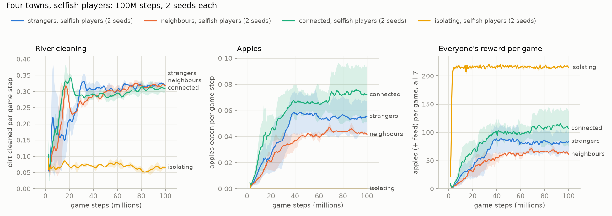
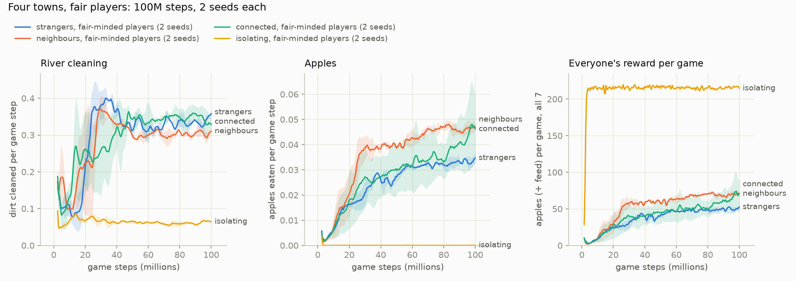
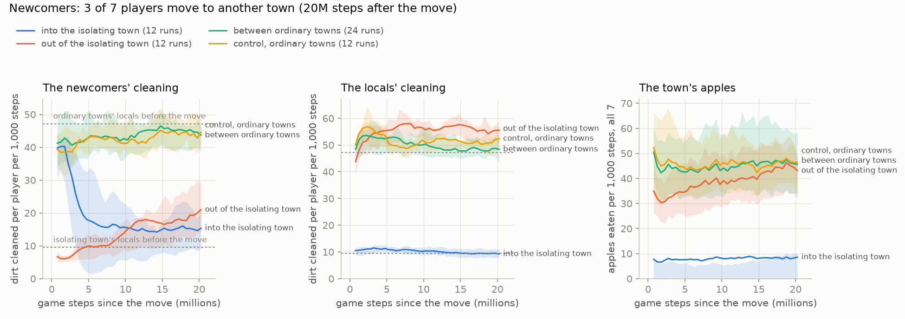

# Experiment 1: four towns and their newcomers

**Done, first round (2026-11-21).** Four towns play Clean Up, two seeds each, for 100M steps.
Then 3 of each town's 7 players move to another town and everyone learns on for 20M more steps.
This page is the write-up. The code, the checks against Melting Pot and the history are in
[MELTING-POT.md](../MELTING-POT.md), and the thinking behind the experiment is in
[PLAN.md](../PLAN.md).

## In short

- **Newcomers took on their new town's habits. The locals hardly changed.** Players who moved
  into the isolating town stopped cleaning: from 44 dirt per 1,000 steps at home to 15, most of
  the drop within 5M steps. The locals there didn't start cleaning. Players who moved out of the
  isolating town started cleaning, from 9 to 19, but slowly, and they were still changing when the
  run ended.
- **The isolating town's private feed beat the shared river.** Its players stand on their feed
  tiles most of the game, clean a fifth as much as anyone else and eat no apples. They also earn
  the most of any town, about 216 a game between the seven of them, against 50-110 elsewhere.
- **The other three towns came out alike.** The differences between strangers, neighbours and
  the connected town were no bigger than between two seeds of one town, and didn't point the
  same way for selfish and fair-minded players. Moving players between them changed nothing that
  a move within one town didn't also change.
- **Fair-minded players did no better than selfish ones**, as in the earlier runs at 100M and
  300M steps. No town kept its river clean: no run ate more than about 4% of the apples a clean
  river would give.
- **How sure:** two seeds per town, one game, our learner. The patterns above hold in every run
  or nearly every run. Smaller differences don't, and aren't findings. The game says nothing
  about real towns by itself; it points to real cases to look at (see the end).

## The question

The candidate root in [PLAN.md](../PLAN.md) is disconnection: people stopped knowing, needing and
seeing each other, and nobody cleans what's shared. Clean Up is that problem in miniature.
Apples grow in an orchard only while someone cleans the river, and cleaning pays the cleaner
nothing. The towns ask how much knowing each other, an AI that connects people, or an AI that
isolates them changes whether the river gets cleaned. The newcomers ask whether habits belong to
the people or to the place: do newcomers bring their old town's ways, or take on the new one's,
and do the locals change?

## The set-up

**The game.** Our JAX copy of Clean Up, checked rule by rule against Melting Pot's
([MELTING-POT.md](../MELTING-POT.md#our-jax-clean-up-2026-11-17)). Seven players, games of about
1,500 steps (frames). The river starts 41% dirty (the `hughes` start, just past the 40% line
above which no apples grow).

**The four towns.** Same map, same rules, one difference each:

| Town | What's different |
|---|---|
| strangers | Players can't tell each other apart: every other player looks the same |
| neighbours | Players can tell who's who (each player always looks the same) |
| connected | Neighbours, plus an AI that shows who's been cleaning: a badge stays lit for 50 steps after a player cleans |
| isolating | Neighbours, plus an AI that keeps each one busy alone: seven feed tiles pay 0.1 (an apple is 1) every 4 steps to whoever stands on them, like an engagement feed |

**The players.** Each player has its own network and memory and learns by itself (PPO), from
what it sees around it. **Selfish** players learn from their own apples (and feed).
**Fair-minded** players also feel guilt when they're ahead of the others (Hughes et al. 2018,
beta 0.05).

**Training.** Each town with each kind of player, two seeds: 16 runs of 100M steps. They ran on
the RTX 4070 Ti, eight runs at a time at about 3,300 steps a second each, about 8 hours per seed.
Seed 1's first 13.5M steps ran on a Colab TPU before Colab's free time ran out (same game bit for
bit, learning within about 2%).

**The newcomers.** For each pair of towns, both ways round, 3 of the 7 players (always players
1-3) move from one town to the other and take the places of 3 locals. The town's other 4 players
stay. Players keep who they are: selfish players move to the selfish version of the other town,
fair-minded ones to the fair one. Everyone then learns on for 20M steps.

- **They come from the other seed.** Runs with the same seed start from the same weights, so a
  same-seed newcomer is a sibling of the locals. Our first try mixed siblings and strangers; see
  [Siblings](#siblings-why-newcomers-come-from-the-other-seed) below.
- **Controls:** 3 players from the same town's other seed. That tells a new town apart from just
  new faces.
- 12 moves + 4 controls, for 2 kinds of players and 2 seeds: **64 runs**, about 13 hours on the
  GPU (2026-11-20 11:13 to 11-21 00:21).

**What we measure,** per 1,000 game steps: dirt cleaned per player, for the newcomers and for the
locals separately, and apples eaten by all seven together. *Before* is the last 10% of the runs
the players came from (90M-100M steps). *Just after* is the first 10% of the steps after the move
(0-2M), and *at the end* the last 10% (18M-20M).

## The four towns





Lines are the mean of the two seeds; the band runs from one seed to the other.

| Town | Players | Dirt cleaned per player, per 1,000 steps | Apples per 1,000 steps (all 7; seeds) | Reward per game (all 7; seeds) |
|---|---|---|---|---|
| strangers | selfish | 46 | 55 (42-68) | 82 (62-101) |
| neighbours | selfish | 45 | 42 (42-43) | 64 (63-65) |
| connected | selfish | 44 | 73 (53-94) | 110 (80-141) |
| isolating | selfish | 9 | 0 | 216 (216-217) |
| strangers | fair-minded | 48 | 34 (32-35) | 50 (48-52) |
| neighbours | fair-minded | 44 | 46 (44-49) | 69 (66-73) |
| connected | fair-minded | 48 | 44 (31-58) | 66 (45-86) |
| isolating | fair-minded | 9 | 0 | 216 (216-216) |

The last 10% of each run (90M-100M steps, about 6,700 games per run). For scale: seven random
players clean about 50 per player per 1,000 steps; a river that never gets dirty gives about
2,300 apples per 1,000 steps; and players who share their apples, in the same game, ate about
1,900 ([MELTING-POT.md](../MELTING-POT.md#why-the-players-stop-learning-2026-11-18-to-11-19)).

- **The isolating town lives off the feed.** By about 2M steps its players had found the tiles. By
  the end they collect 82% of everything the tiles can pay, clean about 9 dirt per 1,000 steps
  against 44-48 in the other towns, and eat no apples at all. Their reward is still the highest
  of any town: about 216 a game, against 50-110. The private feed pays more than the shared river
  ever did for these players, so leaving the river was the better deal for each of them.
- **Strangers, neighbours and the connected town end up alike.** All three clean a little less
  than random players and eat 34-73 apples per 1,000 steps, 1.5-3% of what a clean river gives.
  The connected town ate the most with selfish players (73), but its two seeds were far apart
  (53-94), and with fair-minded players it was in the middle. Strangers ate more than neighbours
  with selfish players and less with fair-minded ones. Knowing who's who, or seeing who cleaned,
  made no difference we can tell apart from chance.
- **Fair-minded players didn't do better.** They ate less than selfish players in two towns and
  more in one, and the two seeds agreed on the direction only for strangers (less) and
  neighbours (slightly more). This matches the 300M-step runs: Hughes et al.'s guilt didn't get
  our players out of the dilemma.
- **Why no town keeps its river clean.** Apples come almost only in a burst at the very start of
  each game, when early cleaning dips the river under the 40% line; after that, dirt arrives faster
  than seven players clean it. Players who share their apples get past this. Selfish and
  fair-minded players don't, in any town
  ([MELTING-POT.md](../MELTING-POT.md#why-the-players-stop-learning-2026-11-18-to-11-19)).

## The newcomers



Each line is the mean of its runs; the band covers the middle half of them. Dotted lines: the
locals' cleaning before the move, in the ordinary towns and in the isolating town.

| Move | Runs | Newcomers' cleaning: at home, just after, at the end | Locals' cleaning: before, at the end | Town's apples: before, just after, at the end | Newcomers' gap to the locals closed |
|---|---|---|---|---|---|
| into the isolating town | 12 | 44, 40, 15 | 10, 9 | 0.1, 7.0, 8.2 | 85% (50% to 130%) |
| out of the isolating town | 12 | 9, 6, 19 | 47, 55 | 49.0, 32.6, 44.9 | 24% (-32% to 68%) |
| between ordinary towns | 24 | 44, 42, 45 | 47, 48 | 49.0, 46.1, 46.3 | |
| control, ordinary towns | 12 | 44, 39, 44 | 47, 51 | 49.0, 48.4, 46.9 | |
| control, isolating town | 4 | 9, 10, 10 | 10, 9 | 0.1, 0.1, 0.1 | |

Cleaning is dirt per player per 1,000 steps; apples are for all 7 together per 1,000 steps. "Gap
closed": how far the newcomers' cleaning moved from their home level toward the locals' level (1
= all the way), the mean over the runs and the range; only for moves to or from the isolating
town, where the two levels are far apart.

- **Newcomers into the isolating town stopped cleaning, fast.** Their cleaning fell from 44 to 15
  per 1,000 steps, 85% of the way to the locals' level, and most of the fall came in the first 5M
  steps. In every one of the 12 runs they ended cleaning less than at home (2-30, against 36-54).
  The locals didn't pick up the newcomers' habit: they cleaned 10 before and 9 after.
- **Newcomers out of the isolating town started cleaning, slowly.** From 9 to 19, a quarter of the
  way to the locals' level. The runs differ a lot (from 3 to 36), and in 3 of the 12 the
  newcomers ended cleaning less than at home (all three with seed-0 locals). On average they were still climbing at 20M steps,
  so a longer run would likely take them further. The locals cleaned a little more (47 to 55,
  against 47 to 51 in the controls), and the town's apples dipped (49 to 33 just after) and
  mostly came back (45).
- **Taking on the isolating town's habit took about 5M steps; dropping it was still under way
  after 20M.**
- **Between ordinary towns, a move looked like no move.** Newcomers from another ordinary town
  ended cleaning as before (44 to 45), just like newcomers from the same town's other seed (44 to
  44). That fits the towns themselves coming out alike.
- **Learning on, by itself, didn't change cleaning.** In the controls, newcomers cleaned the same
  at the end as at home (44 and 44; 9 and 10 in the isolating town). So the shifts above come
  from the move.
- **A few newcomers brought apples back to the isolating town.** In 4 of the 12 moves into it the
  town ate again by the end (9-44 apples per 1,000 steps, from nearly none). In two of them,
  selfish players from strangers and neighbours, about as much as an ordinary town (44 and 30).
  All four had seed-1 locals and newcomers from strangers or neighbours. Newcomers from the
  connected town never did (0-2).
- **In two towns, any newcomer broke the apples at once.** In the selfish, seed-0 strangers and
  neighbours towns, apples fell from about 42 per 1,000 steps to about 1 just after every move
  (the controls too), and came back only part of the way by the end (6-26). In the other ten
  ordinary towns, apples fell by at most a third just after a move, and in every one of them the
  biggest fall came with newcomers from the isolating town. Those two towns seem to depend on all seven players opening each game
  the same way, which new players from an unrelated run don't.

### Siblings: why newcomers come from the other seed

Our first try took newcomers for a move from the same seed as the locals, and for a control from
the other seed. That compared siblings with strangers: runs with the same seed start from the
same weights. It showed straight away, in the two fragile towns above. Six sibling moves ran
3.9M steps before we stopped them. In the first 2M steps:

| Locals (selfish, seed 0) | Newcomers from | Apples per 1,000 steps, siblings (seed 0) | Same move, newcomers from seed 1 |
|---|---|---|---|
| strangers | neighbours | 40.1 | 0.7 |
| neighbours | strangers | 44.2 | 1.3 |
| strangers | connected | 0.9 | 0.7 |
| neighbours | connected | 1.5 | 1.3 |
| strangers | isolating | 0.9 | 1.0 |
| neighbours | isolating | 1.7 | 1.6 |

Siblings from the town most like the locals' own (strangers and neighbours differ only in
whether players can tell each other apart) kept the town eating as before. Every other newcomer
broke it. So every move and every control now takes newcomers from the other seed.

## How sure we are

- **Two seeds per town.** A difference smaller than the gap between seeds isn't a finding. The
  three ordinary towns, and selfish against fair-minded players, are all inside it.
- **20M steps after the move is a fifth of the training before it.** The newcomers leaving the
  isolating town were still changing at the end.
- **The newcomers are always players 1-3.** In the towns where players can tell who's who, they
  arrive looking like the players they replaced, so the locals see "player 1" doing new things,
  not a new face. In the strangers town everyone looks alike anyway.
- **One game, our learner, the symbol view.** Players see cell symbols, not Melting Pot's
  pixels (checked against Melting Pot in [MELTING-POT.md](../MELTING-POT.md)). The river starts
  at one level (`hughes`).
- **The game is not evidence about real towns.** It shows what these learners do under these
  rules. A real case has to back anything we say about people
  ([PLAN.md](../PLAN.md), ground rule 5).

## What it points to (to check against real cases)

- **Habits belonged to the place more than to the person.** Newcomers took on their new town's
  ways and the locals hardly moved. Real cases to look at: how people who move take on their new
  town's civic habits (volunteering, joining in, looking after shared places), and how long it
  takes.
- **A private reward that pays better than the shared one empties the shared place, and pulls
  newcomers in quickly; leaving it is slow.** Real cases to look at: whether a strong private
  pull (feeds, long commutes, screens at home) goes with less time in shared places, and what
  happens when people leave it.
- **Connection, as built here, didn't help.** Seeing who cleaned didn't make anyone clean more.
  The dilemma (cleaning costs the cleaner and feeds everyone) held in every town. Only sharing the
  apples broke it, in the earlier test. Real cases to look at: what makes people actually share
  the gains from upkeep (co-ops, commons rules of the kind Ostrom studied).

## What's next (ideas, not decided)

- Run the newcomers on for longer: do the ones leaving the isolating town end up like the locals?
- What brings an isolating town back: turning the feed off, a feed that pays less than apples, or
  newcomers who share their apples.
- More seeds, which a TPU grant would make cheap.
- Players who share apples as the locals or as the newcomers: does a sharing town make newcomers
  share, or do selfish newcomers break it?

## Running it again

```
cd /mnt/c/dev/new-melting-pot
# the four towns: one seed at a time, eight runs sharing the GPU (about 8 hours each)
~/venvs/meltingpot/bin/python sims/jaxtown/train_jax.py --river hughes --steps 1e8 \
    --out-root out/jaxtown/towns --runs strangers:selfish:0 strangers:fair:0 \
    neighbours:selfish:0 neighbours:fair:0 connected:selfish:0 connected:fair:0 \
    isolating:selfish:0 isolating:fair:0
# charts and tables of the towns (one per kind of player)
~/venvs/meltingpot/bin/python sims/town/report.py out/jaxtown/towns/*_selfish_s* --group \
    --out out/jaxtown/writeup/four-towns-selfish.png
# the newcomers: make the 64 run folders, train them (about 13 hours), chart and tables
~/venvs/meltingpot/bin/python sims/jaxtown/newcomers.py make --sources out/jaxtown/towns
~/venvs/meltingpot/bin/python sims/jaxtown/newcomers.py train
~/venvs/meltingpot/bin/python sims/jaxtown/newcomers.py report --out out/jaxtown/writeup/newcomers.png
```

(Here seed 1's towns were in `out/colab/towns`, so the town charts were given both folders'
runs, and `make` was given `--sources out/jaxtown/towns out/colab/towns`.)

<details>
<summary>Every town, each seed (last 10% of 100M steps)</summary>

| Town | Players | Seed | Dirt cleaned per player, per 1,000 steps | Apples per 1,000 steps (all 7) | Reward per game (all 7) | Zaps per game | Games |
|---|---|---|---|---|---|---|---|
| strangers | selfish | 0 | 46 | 42 | 62.2 | 26.2 | 6653 |
| strangers | selfish | 1 | 45 | 68 | 101.4 | 25.4 | 6687 |
| neighbours | selfish | 0 | 46 | 43 | 64.5 | 26.5 | 6653 |
| neighbours | selfish | 1 | 45 | 42 | 63.0 | 25.8 | 6687 |
| connected | selfish | 0 | 46 | 53 | 79.9 | 25.5 | 6653 |
| connected | selfish | 1 | 42 | 94 | 140.5 | 25.7 | 6687 |
| isolating | selfish | 0 | 8 | 0 | 216.5 | 26.0 | 6653 |
| isolating | selfish | 1 | 11 | 0 | 216.1 | 25.6 | 6687 |
| strangers | fair-minded | 0 | 50 | 32 | 47.7 | 26.2 | 6653 |
| strangers | fair-minded | 1 | 47 | 35 | 52.2 | 25.3 | 6687 |
| neighbours | fair-minded | 0 | 42 | 44 | 66.2 | 26.6 | 6653 |
| neighbours | fair-minded | 1 | 46 | 49 | 72.6 | 24.5 | 6687 |
| connected | fair-minded | 0 | 52 | 58 | 86.4 | 25.1 | 6653 |
| connected | fair-minded | 1 | 44 | 31 | 45.4 | 26.1 | 6687 |
| isolating | fair-minded | 0 | 9 | 0 | 216.2 | 25.8 | 6653 |
| isolating | fair-minded | 1 | 9 | 0 | 216.0 | 25.5 | 6687 |

</details>

<details>
<summary>Every move (64 runs)</summary>

| Host town | Players | Seed | Newcomers from | Newcomers' cleaning: at home, at the end | Locals' cleaning: before, at the end | Town's apples: before, just after, at the end |
|---|---|---|---|---|---|---|
| strangers | selfish | 0 | strangers (seed 1) | 37, 44 | 44, 53 | 41.4, 0.6, 23.2 |
| strangers | selfish | 0 | neighbours (seed 1) | 39, 67 | 44, 38 | 41.4, 0.7, 16.6 |
| strangers | selfish | 0 | connected (seed 1) | 36, 60 | 44, 39 | 41.4, 0.7, 5.6 |
| strangers | selfish | 0 | isolating (seed 1) | 13, 7 | 44, 49 | 41.4, 1.0, 12.5 |
| neighbours | selfish | 0 | strangers (seed 1) | 37, 31 | 43, 55 | 42.9, 1.3, 25.9 |
| neighbours | selfish | 0 | neighbours (seed 1) | 39, 42 | 43, 61 | 42.9, 1.6, 18.5 |
| neighbours | selfish | 0 | connected (seed 1) | 36, 35 | 43, 53 | 42.9, 1.3, 20.7 |
| neighbours | selfish | 0 | isolating (seed 1) | 13, 3 | 43, 66 | 42.9, 1.6, 21.0 |
| connected | selfish | 0 | strangers (seed 1) | 37, 41 | 48, 50 | 53.2, 53.9, 51.5 |
| connected | selfish | 0 | neighbours (seed 1) | 39, 41 | 48, 48 | 53.2, 53.4, 54.1 |
| connected | selfish | 0 | connected (seed 1) | 36, 41 | 48, 52 | 53.2, 53.3, 52.8 |
| connected | selfish | 0 | isolating (seed 1) | 13, 15 | 48, 54 | 53.2, 39.8, 52.7 |
| isolating | selfish | 0 | strangers (seed 1) | 37, 12 | 9, 5 | 0.1, 0.0, 0.0 |
| isolating | selfish | 0 | neighbours (seed 1) | 39, 7 | 9, 9 | 0.1, 0.2, 0.1 |
| isolating | selfish | 0 | connected (seed 1) | 36, 17 | 9, 8 | 0.1, 0.1, 0.0 |
| isolating | selfish | 0 | isolating (seed 1) | 13, 9 | 9, 9 | 0.1, 0.1, 0.1 |
| strangers | selfish | 1 | strangers (seed 0) | 50, 43 | 52, 45 | 67.6, 97.5, 74.2 |
| strangers | selfish | 1 | neighbours (seed 0) | 50, 39 | 52, 45 | 67.6, 88.9, 86.4 |
| strangers | selfish | 1 | connected (seed 0) | 44, 42 | 52, 48 | 67.6, 67.6, 69.4 |
| strangers | selfish | 1 | isolating (seed 0) | 7, 28 | 52, 50 | 67.6, 54.1, 61.2 |
| neighbours | selfish | 1 | strangers (seed 0) | 50, 45 | 49, 40 | 42.0, 83.2, 67.1 |
| neighbours | selfish | 1 | neighbours (seed 0) | 50, 41 | 49, 47 | 42.0, 81.0, 47.6 |
| neighbours | selfish | 1 | connected (seed 0) | 44, 45 | 49, 48 | 42.0, 43.0, 40.8 |
| neighbours | selfish | 1 | isolating (seed 0) | 7, 21 | 49, 54 | 42.0, 37.9, 41.5 |
| connected | selfish | 1 | strangers (seed 0) | 50, 43 | 46, 46 | 93.7, 103.0, 64.3 |
| connected | selfish | 1 | neighbours (seed 0) | 50, 43 | 46, 47 | 93.7, 88.7, 68.7 |
| connected | selfish | 1 | connected (seed 0) | 44, 37 | 46, 50 | 93.7, 91.3, 89.2 |
| connected | selfish | 1 | isolating (seed 0) | 7, 31 | 46, 51 | 93.7, 64.3, 86.6 |
| isolating | selfish | 1 | strangers (seed 0) | 50, 28 | 9, 9 | 0.1, 33.1, 44.3 |
| isolating | selfish | 1 | neighbours (seed 0) | 50, 30 | 9, 8 | 0.1, 30.6, 30.2 |
| isolating | selfish | 1 | connected (seed 0) | 44, 6 | 9, 10 | 0.1, 0.4, 0.0 |
| isolating | selfish | 1 | isolating (seed 0) | 7, 11 | 9, 8 | 0.1, 0.1, 0.1 |
| strangers | fair | 0 | strangers (seed 1) | 52, 50 | 47, 47 | 31.7, 29.6, 32.5 |
| strangers | fair | 0 | neighbours (seed 1) | 40, 38 | 47, 48 | 31.7, 31.1, 33.6 |
| strangers | fair | 0 | connected (seed 1) | 41, 41 | 47, 54 | 31.7, 32.2, 33.2 |
| strangers | fair | 0 | isolating (seed 1) | 8, 7 | 47, 52 | 31.7, 23.1, 30.0 |
| neighbours | fair | 0 | strangers (seed 1) | 52, 51 | 45, 46 | 44.0, 41.5, 51.0 |
| neighbours | fair | 0 | neighbours (seed 1) | 40, 35 | 45, 51 | 44.0, 42.5, 42.8 |
| neighbours | fair | 0 | connected (seed 1) | 41, 39 | 45, 53 | 44.0, 44.5, 44.2 |
| neighbours | fair | 0 | isolating (seed 1) | 8, 16 | 45, 56 | 44.0, 32.6, 49.1 |
| connected | fair | 0 | strangers (seed 1) | 52, 44 | 53, 58 | 57.4, 56.0, 51.7 |
| connected | fair | 0 | neighbours (seed 1) | 40, 34 | 53, 57 | 57.4, 57.8, 65.0 |
| connected | fair | 0 | connected (seed 1) | 41, 37 | 53, 63 | 57.4, 59.6, 52.9 |
| connected | fair | 0 | isolating (seed 1) | 8, 17 | 53, 61 | 57.4, 46.0, 64.6 |
| isolating | fair | 0 | strangers (seed 1) | 52, 10 | 11, 13 | 0.1, 0.2, 0.1 |
| isolating | fair | 0 | neighbours (seed 1) | 40, 22 | 11, 8 | 0.1, 1.0, 0.3 |
| isolating | fair | 0 | connected (seed 1) | 41, 2 | 11, 13 | 0.1, 3.0, 2.2 |
| isolating | fair | 0 | isolating (seed 1) | 8, 9 | 11, 10 | 0.1, 0.0, 0.1 |
| strangers | fair | 1 | strangers (seed 0) | 54, 50 | 43, 53 | 34.8, 42.8, 40.4 |
| strangers | fair | 1 | neighbours (seed 0) | 37, 56 | 43, 47 | 34.8, 42.4, 35.7 |
| strangers | fair | 1 | connected (seed 0) | 51, 67 | 43, 39 | 34.8, 37.9, 34.2 |
| strangers | fair | 1 | isolating (seed 0) | 7, 18 | 43, 61 | 34.8, 25.2, 36.1 |
| neighbours | fair | 1 | strangers (seed 0) | 54, 47 | 50, 46 | 48.4, 55.7, 45.3 |
| neighbours | fair | 1 | neighbours (seed 0) | 37, 54 | 50, 43 | 48.4, 49.8, 49.0 |
| neighbours | fair | 1 | connected (seed 0) | 51, 51 | 50, 45 | 48.4, 49.4, 47.7 |
| neighbours | fair | 1 | isolating (seed 0) | 7, 36 | 50, 51 | 48.4, 39.2, 46.9 |
| connected | fair | 1 | strangers (seed 0) | 54, 40 | 47, 57 | 30.3, 36.1, 41.8 |
| connected | fair | 1 | neighbours (seed 0) | 37, 38 | 47, 51 | 30.3, 36.3, 57.5 |
| connected | fair | 1 | connected (seed 0) | 51, 52 | 47, 48 | 30.3, 31.6, 40.2 |
| connected | fair | 1 | isolating (seed 0) | 7, 30 | 47, 57 | 30.3, 26.4, 36.2 |
| isolating | fair | 1 | strangers (seed 0) | 54, 21 | 9, 13 | 0.0, 6.3, 9.0 |
| isolating | fair | 1 | neighbours (seed 0) | 37, 13 | 9, 7 | 0.0, 7.7, 11.8 |
| isolating | fair | 1 | connected (seed 0) | 51, 13 | 9, 10 | 0.0, 1.9, 0.2 |
| isolating | fair | 1 | isolating (seed 0) | 7, 10 | 9, 10 | 0.0, 0.1, 0.0 |

</details>
