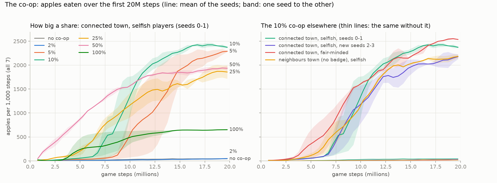

# Experiment 2: a co-op that pays the cleaners

**Done, first round (2026-11-21).** In experiment 1 no town kept its river clean. Here the
connecting AI takes a small share of every apple eaten and pays it to whoever cleaned the river
lately. We tried shares from 2% to 100% of each apple, then checked the 10% share on new seeds,
with fair-minded players, and in a town with no badge. This page is the write-up. The rule's code
and checks are in [MELTING-POT.md](../MELTING-POT.md#the-co-op-2026-11-21), and experiment 1 is
in [01-newcomers.md](01-newcomers.md). Part 2, players moving into and out of a co-op town, is in
[02b-coop-newcomers.md](02b-coop-newcomers.md), and part 3, a co-op town losing one cleaner, in
[02c-losing-a-cleaner.md](02c-losing-a-cleaner.md).

**Corrected 2026-11-22.** The first version said two players did all the cleaning and still ate.
It was one player, who ate nothing. We had averaged each game's two top cleaners, which put the
one cleaner together with an eater. The parts about who does the work are fixed below; the
apples, the payouts and the take-off times were right and haven't changed.

## In short

- **A small share breaks the dilemma.** With 10% of every apple going to recent cleaners, the
  connected town ate about 2,400 apples per 1,000 steps by 18M-20M steps, against 43 without the
  co-op. That's about what a river that never gets dirty gives (about 2,300). The best town in
  experiment 1 ate 94, after 100M steps.
- **5% was enough; 2% wasn't, yet.** 5% got there too, a few million steps later than 10%. 2%
  looked just like no co-op after 20M steps.
- **More isn't better.** 25% and 50% ate less than 10%. 50% got going fastest, but more of its
  players cleaned and fewer ate. At 100% an apple paid its eater nothing unless they'd cleaned,
  so the town ate about a quarter as much.
- **It held everywhere we tried it.** At 10%: on two new seeds (about 2,100 against 29 without),
  with fair-minded players (about 2,500 against 17), and in the neighbours town (about 2,150
  against 21). That town has no badge, so the payment works without anyone seeing who cleaned.
- **One player became the town's cleaner.** At 5% and 10%, in every town that took off, one
  player did all the cleaning, in every game, and ate nothing. They lived off the pot: about 240
  per 1,000 steps at 10% (about 110 at 5%), against about 360 for each of the six who ate.
  Without the co-op, everyone earned about 6.
- **How sure:** two seeds per setting (four at 10%), 20M steps, one game, our learner. The jump is
  far bigger than any gap between seeds; the order of the shares from 5% to 50% is not firm.

## The question

Experiment 1 ended with the same dilemma in every town: cleaning costs the cleaner and feeds
everyone. Seeing who cleaned (the connected town's badge) didn't help. Neither did guilt
(Hughes et al. 2018's fair-minded players, in our runs). The only thing that broke it, in an
earlier test, was players who share all their apples
([MELTING-POT.md](../MELTING-POT.md#why-the-players-stop-learning-2026-11-18-to-11-19)).
[Hughes et al.](https://arxiv.org/abs/1803.08884) also found that envy, the other half of their
model, "has no such positive impact in the Cleanup game": fining free riders "does not directly
increase the attractiveness of waste cleaning".

So we tried the reverse of a fine. What if the connecting AI acts like a co-op: it takes part of
the gains the clean river makes possible and pays it to the people who do the upkeep? How small
can that share be and still work? This is the "partnership" picture in [PLAN.md](../PLAN.md): the
AI routes part of the gains to the people, rather than keeping them.

## The set-up

**The game, the players and the river** are experiment 1's: our JAX Clean Up, seven players,
selfish (or fair-minded) learners, the river starting 41% dirty (`hughes`).

**The co-op rule.** Every apple eaten pays a share of itself into a pot. The pot is split evenly
between the players who cleaned in the last 50 steps (the same record that lights the connected
town's badge). An eater who cleaned recently gets part of it back. If nobody cleaned recently,
eaters keep their apples whole. The rule moves reward between players and changes nothing else in
the game. We checked that side by side with the game before it
([MELTING-POT.md](../MELTING-POT.md#the-co-op-2026-11-21)).

**Training.** Each run is 20M steps, a fifth of experiment 1's towns. A run with the same seed
starts from the same weights as experiment 1's run of that town. So for seeds 0 and 1, the first
20M steps of experiment 1's runs are the comparison "without the co-op". For the new seeds, 2
and 3, we trained the town without the co-op as well.

- **The pilot:** the connected town, selfish players, seeds 0 and 1, shares 10%, 25%, 50% and
  100%. Eight runs sharing the RTX 4070 Ti at about 3,170 steps a second each, 1¾ hours.
- **Round 2:** shares 2% and 5% (seeds 0 and 1), and 10% and no co-op on seeds 2 and 3. Eight
  runs, 1¾ hours. Then 10% with fair-minded players in the connected town and with selfish
  players in the neighbours town (seeds 0 and 1). Four runs, an hour.

**What we measure,** per 1,000 game steps, over the last 10% of the runs (18M-20M steps, about
1,300-1,400 games per run):

- apples eaten by all seven together;
- dirt cleaned per player;
- the reward the co-op paid out (what the players it paid gained);
- how many players did the cleaning (each at least a tenth of the town's);
- when the town first ate 1,000 apples per 1,000 steps, in a stretch of 1M steps.

## How big a share



Lines are the mean of the seeds; the band runs from one seed to the other.

| Co-op share | Apples per 1,000 steps (all 7; seeds) | Dirt cleaned per player | Paid out by the co-op | Players who did the cleaning (seeds) | First reached 1,000 apples (seeds) |
|---|---|---|---|---|---|
| none | 43 (29-56) | 47 | 0 | 5, 3 | not by 20M, not by 20M |
| 2% | 43 (42-43) | 45 | 1 | 6, 6 | not by 20M, not by 20M |
| 5% | 2,250 (2,181-2,320) | 72 | 112 | 1, 1 | 15M, 11M |
| 10% | 2,399 (2,396-2,401) | 72 | 239 | 1, 1 | 9M, 11M |
| 25% | 1,858 (1,721-1,996) | 71 | 431 | 2, 2 | 9M, 12M |
| 50% | 1,930 (1,897-1,963) | 72 | 832 | 4, 3 | 7M, 6M |
| 100% | 647 (641-654) | 73 | 555 | 6, 6 | not by 20M, not by 20M |

The connected town, selfish players, seeds 0 and 1. For scale: a river that never gets dirty
gives about 2,300 apples per 1,000 steps. Players who share all their apples (the neighbours
town, one seed) ate about 1,100 at 18M-20M steps, first reached 1,000 at 18M, and ate about 1,900
after 100M steps
([MELTING-POT.md](../MELTING-POT.md#why-the-players-stop-learning-2026-11-18-to-11-19)).

- **From 5% to 50%, the town took off.** It ate 1,860-2,400 apples per 1,000 steps by the end,
  40 to 55 times as much as without the co-op, and about as much as a clean river. A 10% share
  got there faster than sharing everything: 1,000 apples by 9-11M steps, against 18M for players
  who share all their apples.
- **2% did nothing we can see in 20M steps.** The pot paid out about 1 per 1,000 steps, too
  little to teach anyone to clean. 5% took off later than 10% (11M and 15M, against 9M and 11M).
  So 2% might still take off in a longer run; we don't know.
- **50% got going fastest, but 10% ended highest.** At 50% the town ate more from the first 2M
  steps. By the end three or four of its players cleaned and ate little (about 40 apples each
  per 1,000 steps), living off the pot, and the town ate a little less than at 10%.
- **At 100%, eating stops paying.** An eater gives the whole apple away and gets a share back only
  if they cleaned recently. Six of the seven cleaned, about equally, and ate nothing; the seventh
  ate every apple and cleaned a little. All seven earned the same, about 92 per 1,000 steps, and
  the town ate about a quarter as much as at 10%.

## Does it hold up?

| Setting | Apples without the co-op (seeds) | Apples with 10% (seeds) | Dirt cleaned per player, without and with |
|---|---|---|---|
| connected town, selfish, seeds 0-1 | 43 (29-56) | 2,399 (2,396-2,401) | 47, 72 |
| connected town, selfish, new seeds 2-3 | 29 (20-38) | 2,134 (2,016-2,251) | 41, 72 |
| connected town, fair-minded | 17 (6-27) | 2,535 (2,527-2,543) | 37, 72 |
| neighbours town (no badge), selfish | 21 (14-27) | 2,151 (2,092-2,209) | 38, 72 |

18M-20M steps, per 1,000 steps.

- **New seeds:** both took off (by 12M and 9M steps), ending a little lower than seeds 0 and 1.
- **Fair-minded players** did as well as selfish ones, slightly better: both their seeds ate a
  little more than both selfish seeds. Without the co-op they did no better, as in experiment 1.
  Their guilt now compares what players get after the co-op.
- **The neighbours town has no badge.** Its players can tell who's who, but no badge shows who
  cleaned. The co-op still pays by the same record, and the town took off about as well as the
  connected town did. So the payment works on the cleaner's own reward: nobody needs to see who
  cleaned. That fits experiment 1, where the connected town's players mostly ignored the badge.

## Who does the work, who earns

| Setting | Co-op share | Players who did the cleaning (seeds) | Each of them: reward, apples eaten | Each of the others: reward, apples eaten |
|---|---|---|---|---|
| connected town, selfish | none | 5, 3 | 5, 5 | 7, 7 |
| connected town, selfish | 2% | 6, 6 | 6, 6 | 7, 7 |
| connected town, selfish | 5% | 1, 1 | 112, 0 | 356, 375 |
| connected town, selfish | 10% | 1, 1 | 239, 0 | 360, 400 |
| connected town, selfish | 25% | 2, 2 | 255, 39 | 270, 356 |
| connected town, selfish | 50% | 4, 3 | 287, 43 | 265, 507 |
| connected town, selfish | 100% | 6, 6 | 92, 0 | 92, 647 |
| connected town, selfish, new seeds 2-3 | 10% | 1, 1 | 212, 0 | 320, 356 |
| connected town, fair-minded | 10% | 1, 1 | 251, 0 | 381, 423 |
| neighbours town (no badge), selfish | 10% | 1, 1 | 213, 0 | 323, 358 |

Per player, per 1,000 steps, 18M-20M steps. A player counts as one who did the cleaning if they
did at least a tenth of the town's cleaning over those steps.

- **The town split into one cleaner and six eaters.** At 5% and 10%, in every town that took
  off, one player did all the cleaning, in every game, and ate nothing. The other six cleaned
  next to nothing. Players who share all their apples split the work too: after 100M steps,
  three of them did nearly all the cleaning and ate almost nothing
  ([MELTING-POT.md](../MELTING-POT.md#why-the-players-stop-learning-2026-11-18-to-11-19)).
- **At small shares, the cleaner earns least.** The cleaner's pay is the whole pot. At 10% that
  was 200-251 per 1,000 steps across the eight runs, against about 320-380 for each of the
  others. At 5% it was about 110, under a third of what the others earned. Without the co-op,
  everyone made about 6, so at 10% the cleaner was still about 40 times as well off.
- **Bigger shares, more cleaners, more even pay.** At 25%, two players cleaned and ate little,
  and earned a little less than the others (255 and 270). At 50%, three or four cleaned and
  earned a little more (287 and 265). At 100%, six cleaned and all seven earned the same.

## How sure we are

- **Two seeds per setting, four for 10% in the connected town.** The jump from about 40 to
  about 2,000-2,500 apples is far bigger than any gap between seeds, in every setting we tried.
  The order of 5%, 10%, 25% and 50% isn't firm: their seeds overlap or nearly do.
- **20M steps.** 2% might take off later. We don't know yet whether the co-op towns hold for
  100M steps. Without the co-op, experiment 1's towns never took off in 100M.
- **The AI knows exactly who cleaned.** Its record is perfect and free. Knowing who did the
  upkeep is rarely that easy outside a game.
- **The share is set from outside.** The players didn't choose it, can't vote on it and can't
  leave. The AI keeps nothing for itself.
- **One game, our learner, the symbol view, one river start** (`hughes`).
- **The game is not evidence about real towns.** It shows what these learners do under these
  rules. A real case has to back anything we say about people
  ([PLAN.md](../PLAN.md), ground rule 5).

## What it points to (to check against real cases)

- **A small, steady payment to whoever does the upkeep, taken from the gains it makes possible,
  broke the dilemma where seeing, guilt and envy didn't.** Real cases to look at: payments to
  the people who keep a shared resource in good shape, for example cities paying upstream farmers
  to keep their water clean, and co-ops that pay members for upkeep.
- **Seeing who did the work didn't matter; paying them did.** Real cases to look at: whether
  thanks, ratings and badges for volunteer upkeep hold up without pay, and what changes when it
  is paid.
- **The work became one player's job, and at small shares the worst-paid one.** Real cases to
  look at: who ends up doing upkeep work that everyone benefits from, and whether they're paid
  less than the people who benefit.
- **Too big a cut backfires.** When the pot took the whole apple, eating stopped paying and the
  town ate less. Real cases to look at: levies so high that the activity they fund shrinks.

## What's next (ideas, not decided)

- **Newcomers in a co-op town:** done, in [02b-coop-newcomers.md](02b-coop-newcomers.md), and
  losing one cleaner in [02c-losing-a-cleaner.md](02c-losing-a-cleaner.md).
- **Longer runs:** does 2% take off later, and do the co-op towns hold for 100M steps?
- **The AI raising its cut:** a co-op that starts at 10% and keeps more for itself over time is
  enshittification in miniature. When does the town stop cleaning?
- **A noisy record:** what if the AI sometimes pays the wrong player?
- **Players setting the share themselves**, for example by voting.

## Running it again

```
cd /mnt/c/dev/new-melting-pot
# the pilot: connected town, selfish, seeds 0 and 1, four shares (about 1 3/4 hours)
~/venvs/meltingpot/bin/python sims/jaxtown/train_jax.py --river hughes --steps 2e7 \
    --out-root out/jaxtown/coop_pilot --runs connected:selfish:{0,1}:melting_pot:{0.1,0.25,0.5,1}
# round 2: smaller shares, new seeds (about 1 3/4 hours), then fair players and another town
~/venvs/meltingpot/bin/python sims/jaxtown/train_jax.py --river hughes --steps 2e7 \
    --out-root out/jaxtown/coop_round2 --runs connected:selfish:{0,1}:melting_pot:{0.02,0.05} \
    connected:selfish:{2,3}:melting_pot:0.1 connected:selfish:2 connected:selfish:3
~/venvs/meltingpot/bin/python sims/jaxtown/train_jax.py --river hughes --steps 2e7 \
    --out-root out/jaxtown/coop_round2 --runs connected:fair:{0,1}:melting_pot:0.1 \
    neighbours:selfish:{0,1}:melting_pot:0.1
# chart and tables, with experiment 1's towns as the runs without the co-op, and the
# apple-sharing run from the dirt-rule test for scale
~/venvs/meltingpot/bin/python sims/jaxtown/coop_report.py --runs out/jaxtown/coop_pilot \
    out/jaxtown/coop_round2 out/jaxtown/towns out/colab/towns out/jaxtown/dirt \
    --out out/jaxtown/writeup/coop-20m.png
```

<details>
<summary>Every run (18M-20M steps, per 1,000 steps)</summary>

| Town | Players | Co-op share | Seed | Apples (all 7) | Dirt cleaned per player | Paid out by the co-op | Players who did the cleaning | First reached 1,000 apples | Games |
|---|---|---|---|---|---|---|---|---|---|
| connected | fair | none | 0 | 27 | 51 | 0 | 5 | not by 20M | 1356 |
| connected | fair | none | 1 | 6 | 24 | 0 | 4 | not by 20M | 1313 |
| connected | fair | 10% | 0 | 2,543 | 72 | 251 | 1 | 9M | 1385 |
| connected | fair | 10% | 1 | 2,527 | 72 | 250 | 1 | 8M | 1392 |
| connected | selfish | none | 0 | 29 | 44 | 0 | 5 | not by 20M | 1356 |
| connected | selfish | none | 1 | 56 | 50 | 0 | 3 | not by 20M | 1313 |
| connected | selfish | none | 2 | 38 | 39 | 0 | 6 | not by 20M | 1347 |
| connected | selfish | none | 3 | 20 | 42 | 0 | 4 | not by 20M | 1369 |
| connected | selfish | 2% | 0 | 43 | 47 | 1 | 6 | not by 20M | 1385 |
| connected | selfish | 2% | 1 | 42 | 43 | 1 | 6 | not by 20M | 1392 |
| connected | selfish | 5% | 0 | 2,181 | 72 | 108 | 1 | 15M | 1385 |
| connected | selfish | 5% | 1 | 2,320 | 72 | 116 | 1 | 11M | 1392 |
| connected | selfish | 10% | 0 | 2,401 | 72 | 239 | 1 | 9M | 1385 |
| connected | selfish | 10% | 1 | 2,396 | 72 | 239 | 1 | 11M | 1392 |
| connected | selfish | 10% | 2 | 2,251 | 72 | 224 | 1 | 12M | 1347 |
| connected | selfish | 10% | 3 | 2,016 | 72 | 200 | 1 | 9M | 1369 |
| connected | selfish | 25% | 0 | 1,996 | 72 | 496 | 2 | 9M | 1385 |
| connected | selfish | 25% | 1 | 1,721 | 71 | 367 | 2 | 12M | 1392 |
| connected | selfish | 50% | 0 | 1,963 | 72 | 805 | 4 | 7M | 1385 |
| connected | selfish | 50% | 1 | 1,897 | 72 | 859 | 3 | 6M | 1392 |
| connected | selfish | 100% | 0 | 641 | 73 | 550 | 6 | not by 20M | 1385 |
| connected | selfish | 100% | 1 | 654 | 73 | 560 | 6 | not by 20M | 1392 |
| neighbours | selfish | none | 0 | 14 | 37 | 0 | 4 | not by 20M | 1356 |
| neighbours | selfish | none | 1 | 27 | 39 | 0 | 3 | not by 20M | 1313 |
| neighbours | selfish | 10% | 0 | 2,092 | 72 | 207 | 1 | 10M | 1385 |
| neighbours | selfish | 10% | 1 | 2,209 | 72 | 219 | 1 | 11M | 1392 |

Without the co-op, seed 0 is from `out/jaxtown/towns` and seed 1 from `out/colab/towns`
(experiment 1's runs, cut at 20M; seed 1's first 13.5M steps ran on a Colab TPU). Seeds 2 and 3
are round 2's.

</details>
