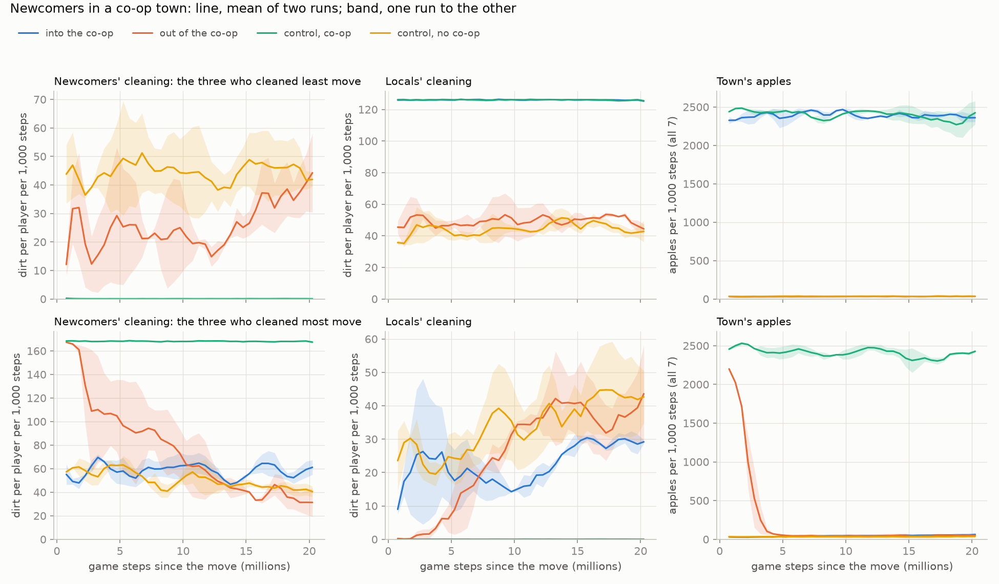

# Experiment 2, part 2: newcomers in a co-op town

**Done, first round (2026-11-22).** In [part 1](02-coop.md) a connecting AI that pays a small
share of every apple to whoever cleaned lately broke Clean Up's dilemma. Here 3 of a town's 7
players move between a town with that co-op and a town without it, and everyone learns on for
20M steps. This page is the write-up. The code and its checks are in
[MELTING-POT.md](../MELTING-POT.md#newcomers-in-a-co-op-town-2026-11-21), and experiment 1's
newcomers are in [01-newcomers.md](01-newcomers.md).

## In short

- **Free riders didn't hurt the co-op.** The three players who cleaned least in a town without
  the co-op moved into a co-op town and stopped cleaning altogether. The town kept eating about
  2,400 apples per 1,000 steps, as it did before.
- **It rested on one player.** Each co-op town had a single cleaner who kept up with the dirt
  alone. That cleaner and two of the co-op's eaters left, and the three who'd cleaned most in a
  town without the co-op took their seats. The apples fell from about 2,400 to about 30 in the
  first games, and were about 55 after 20M steps. A fresh co-op town takes off in 9-12M steps;
  this one hadn't in 20M.
- **The cleaning didn't outlast the pay.** The co-op's cleaner, moved to a town without the
  co-op, kept cleaning flat out at first. That town ate about 2,000 apples per 1,000 steps, about
  70 times its usual, and its own players stopped cleaning. After 2-3M steps the cleaner slowed
  down and the river got dirty. Within 5M steps the town was eating under 70 apples per 1,000
  steps, and about 50 at the end.
- **Eaters took on their new town's ways,** as in experiment 1. The co-op's eaters, moved to a
  town without the co-op, started cleaning a little, like the players already there.
- **How sure:** two runs per kind of move, 20M steps after it, one game, our learner, only the
  10% co-op. The patterns above hold in both runs of each; smaller differences aren't findings.

## The question

Experiment 1 asked whether habits belong to the people or the place. Its newcomers mostly took
on their new town's ways. Part 1 found a rule that keeps a river clean. A rule that only works
while the same players stay wouldn't be worth much, so we asked:

- Do newcomers from a town without the co-op take up cleaning, or ride free and break it?
- Do co-op players keep cleaning in a town where it no longer pays?

## The set-up

**The towns** are part 1's 20M-step runs: the connected town, selfish players, the river starting
41% dirty (`hughes`). With the 10% co-op: seeds 0 and 1. Without it: seeds 2 and 3. Over the last
10% of steps before the move:

- **each co-op town** ate about 2,400 apples per 1,000 steps. One player did all the cleaning,
  in every game: about 500 dirt per 1,000 steps, which is about what arrives (0.5 a step,
  [MELTING-POT.md](../MELTING-POT.md#why-the-players-stop-learning-2026-11-18-to-11-19)). That
  player ate nothing and lived off the pot. The other six cleaned next to nothing and ate about
  400 apples each.
- **each town without the co-op** ate 20-38 apples per 1,000 steps. Four to six of its players
  each did a share of the cleaning, about 40 dirt per player on average.

**The moves.** Three players move; then locals and newcomers all keep learning for 20M steps.
Newcomers always come from a run with another seed: runs with the same seed start from the same
weights, so that would be moving in twins of the locals.

| Move | Newcomers from | Into |
|---|---|---|
| into the co-op | a town without it (seeds 2, 3) | a co-op town (seeds 0, 1) |
| out of the co-op | a co-op town | a town without it |
| control, co-op | the other co-op town | a co-op town |
| control, no co-op | the other town without it | a town without it |

**Who moves.** Players are ranked by how much they cleaned over the last 10% before the move.
Each move runs twice:

- **the three who cleaned least** move, into the seats of the host's three who cleaned least.
  The co-op's cleaner stays.
- **the three who cleaned most** move, into the seats of the host's three who cleaned most. In
  a co-op town those are its one cleaner and two of its eaters. So this is the move that takes a
  co-op town's cleaner away, or brings one in.

That's 16 runs. Each newcomer takes the seat of the local with the same rank. A newcomer in a
different seat from the one it had at home has its view relabelled. That's exact: it changes
nothing about how it plays or learns
([MELTING-POT.md](../MELTING-POT.md#newcomers-in-a-co-op-town-2026-11-21)). Two batches of eight
runs on the RTX 4070 Ti, about 3½ hours.

**What we measure,** per 1,000 game steps: how much the newcomers and the locals cleaned, and
the town's apples (all seven). "At home" and "before" are the last 10% of steps before the move.
"Just after" is the first 2M steps after it, and "at the end" the last 2M.

## What happened



Each line is the mean of a kind of move's two runs; the band runs from one to the other. The first
games end about 0.6M steps after the move. Newcomers' cleaning is per newcomer, the mean of the
three. When the co-op's three top cleaners move, that's its cleaner (about 500) and two eaters
(about 0), so the bottom-left "out of the co-op" line starts at about 168.

| Who moves | Move | Newcomers' cleaning: at home, just after, at the end | Players they replaced, before | Locals' cleaning: before, at the end | Town's apples: before, just after, at the end |
|---|---|---|---|---|---|
| eaters | into the co-op | 21 (29, 13); 0 (0, 0); 0 (0, 0) | 0 (0, 0) | 126 (126, 126); 126 (126, 126) | 2,396 (2,400, 2,392); 2,337 (2,302, 2,373); 2,382 (2,421, 2,343) |
| eaters | out of the co-op | 0 (0, 0); 24 (16, 32); 38 (29, 47) | 21 (29, 13) | 56 (47, 65); 50 (51, 48) | 29 (38, 20); 30 (38, 22); 34 (45, 23) |
| eaters | control, co-op | 0 (0, 0); 0 (0, 0); 0 (0, 0) | 0 (0, 0) | 126 (126, 126); 126 (126, 125) | 2,396 (2,400, 2,392); 2,466 (2,464, 2,467); 2,313 (2,478, 2,148) |
| eaters | control, no co-op | 21 (13, 29); 44 (35, 53); 45 (38, 52) | 21 (29, 13) | 56 (47, 65); 43 (40, 46) | 29 (38, 20); 33 (42, 25); 36 (47, 25) |
| cleaners | into the co-op | 62 (49, 76); 51 (50, 52); 55 (50, 61) | 168 (168, 168) | 0 (0, 0); 29 (32, 27) | 2,396 (2,400, 2,392); 29 (36, 22); 56 (64, 49) |
| cleaners | out of the co-op | 168 (168, 168); 165 (164, 166); 33 (42, 24) | 62 (49, 76) | 25 (32, 18); 38 (30, 46) | 29 (38, 20); 1,996 (1,978, 2,014); 52 (74, 30) |
| cleaners | control, co-op | 168 (168, 168); 168 (168, 168); 168 (168, 168) | 168 (168, 168) | 0 (0, 0); 0 (0, 0) | 2,396 (2,400, 2,392); 2,492 (2,473, 2,511); 2,400 (2,382, 2,418) |
| cleaners | control, no co-op | 62 (76, 49); 60 (61, 58); 42 (37, 47) | 62 (49, 76) | 25 (32, 18); 43 (54, 31) | 29 (38, 20); 33 (27, 39); 36 (26, 47) |

Per 1,000 game steps; the mean of the two runs, then each run in brackets. "eaters" are the three
who cleaned least, "cleaners" the three who cleaned most. Where 126 or 168 is the cleaning of a
co-op town's group of four or three, it's the one cleaner's 500 or so shared out over the group.

### Free riders moving in

The three who cleaned least in a town without the co-op cleaned a little there (29 and 13 dirt
per 1,000 steps). In the co-op town they stopped from their first games and never started again.
The town's cleaner went on as before, the co-op went on paying it about 240 per 1,000 steps, and
the town ate 2,382 at the end, against 2,313 when the same move was made between the two co-op
towns. Newcomers who don't clean just became more of the town's eaters.

### Losing the cleaner

When the co-op's three top cleaners (its cleaner and two eaters) left and the three top cleaners
of a town without the co-op came in, the clean river was gone from the first games: 39 and 24
apples per 1,000 steps in the first 1M steps after the move.

- **The newcomers cleaned about as much as at home** (51 each just after, 62 at home), together
  about a third of what the one cleaner had done. The newcomer in the cleaner's seat cleaned
  60 and 122 in its first 1M steps. A clean river needs about 500.
- **The locals, the co-op's four other eaters, started to clean,** slowly: from nothing to 29
  each by the end. All seven together cleaned about 280 per 1,000 steps.
- **The town never got back.** It crept up from about 30 to about 55 apples over 20M steps and
  was never above about 70 in any half-million steps. With so few apples there was little to share:
  the co-op paid out about 5 per 1,000 steps at the end, against about 240 before.
- **A fresh co-op town does better.** Part 1's 10% towns, starting from players who knew
  nothing, first ate 1,000 apples per 1,000 steps after 9-12M steps. We don't know yet why this
  town didn't. One guess: new players act almost at random, so someone stumbles on cleaning and
  the pot rewards them. These players came with 20M steps of habits from towns where cleaning
  didn't pay, or where someone else did it.

### The cleaner moving out

The co-op's three top cleaners (its cleaner and two eaters) moved into a town without the co-op.
There, cleaning earns nothing but the apples it grows, which anyone can eat.

- **At first the cleaner carried on**, cleaning about 500 per 1,000 steps in its first 1M steps
  in both runs. That town, which had eaten 20-38 apples per 1,000 steps, ate 2,184 and 2,216.
- **The town's own players stopped cleaning.** Before, they cleaned 32 and 18 each. In the first
  2M steps after the move, they cleaned nothing.
- **Then the cleaner slowed down, and the river couldn't take it.** In one run the cleaner was
  down to 199 in the third 1M steps and the town to 422 apples; by the fourth, 68 and 63. In the
  other the cleaner eased off slowly, but at 440 in the fourth 1M steps the town was already
  down to 286 apples. That cleaner kept cleaning about 400 for three million steps after the
  apples were gone, then less and less, down to 6 dirt per 1,000 steps in the last 1M.
- **By the end the town was back near where it started,** at 74 and 30 apples per 1,000 steps
  (38 and 20 before). The locals cleaned again, a little more than before (38 against 25 each).

### Eaters moving out, and the controls

- **The co-op's eaters**, who cleaned nothing, moved into a town without the co-op and started
  cleaning: 24 each just after the move, 38 by the end. Players who moved the same way between
  the two towns without the co-op cleaned 45 by the end. The town's apples didn't change (34, against 36).
- **Swapping cleaners between the two co-op towns** made no difference. Each town's new cleaner
  cleaned about 504 per 1,000 steps in every 1M steps after the move, and the towns ate 2,400 at
  the end. So a co-op cleaner can do the job in another co-op town, in another seat.

## How sure we are

- **Two runs per kind of move and who moves.** The big effects are far bigger than the gap
  between the two runs: about 2,400 apples against about 30 when the cleaner left, about 2,000
  against about 30 when the cleaner arrived. Smaller differences, such as 2,382 against 2,313,
  aren't findings.
- **20M steps after the move.** The town that lost its cleaner was still creeping up at the end.
  It might recover in a longer run.
- **Only the 10% co-op**, the connected town, selfish players and one river start. At 25% two
  players cleaned, and at 50% three or four (part 1). Those towns might cope better with losing
  one.
- **The "cleaners" moves change three players at once:** the cleaner and two eaters. We didn't
  move the cleaner alone.
- **A relabelled newcomer** acts exactly as it would at home (a test checks it), and in the runs
  they did at first: the co-op's cleaner cleaned about 500 in its first 1M steps in another town,
  as at home.
- **The game is not evidence about real towns.** It shows what these learners do under these
  rules. A real case has to back anything we say about people ([PLAN.md](../PLAN.md), ground
  rule 5).

## What it points to (to check against real cases)

- **A paid upkeep job absorbed the free riders.** Newcomers who wouldn't clean just ate, and the
  town did as well as before. Real cases to look at: shared resources that pay for their upkeep
  out of what they produce, and how they fare as members come and go.
- **But it all hung on one person.** Losing the one cleaner ended the clean river at once, and
  newcomers didn't take up the paid job, not even the ones who'd cleaned most at home. Rebuilding
  took longer than starting fresh. Real cases to look at: shared work that rests on one person
  (a project with a single maintainer, a garden one volunteer keeps going), what happens when
  they leave, and whether it's harder to rebuild than to start again.
- **The work stopped when the pay did.** A paid cleaner moved somewhere without the pay kept
  going for a while, the town around them stopped cleaning and ate well, and then the cleaner
  gave up. Real cases to look at: what happens to upkeep when payments for it end, for example
  when a programme that pays landowners to protect water or forest stops paying.

## What's next (ideas, not decided)

- **Two cleaners instead of one:** at 25% two players cleaned. Does such a town survive losing
  one of them?
- **The cleaner alone:** move only the cleaner, or take it away with nobody in its place.
- **Longer runs:** does the town that lost its cleaner recover, the way a fresh co-op town takes
  off?
- **The co-op ending in place:** the same town losing its co-op, to set beside the cleaner who
  moved out.

## Running it again

```
cd /mnt/c/dev/new-melting-pot
# the 16 run folders, from part 1's towns (seconds)
~/venvs/meltingpot/bin/python sims/jaxtown/coop_newcomers.py make \
    --sources out/jaxtown/coop_pilot out/jaxtown/coop_round2 --out-root out/jaxtown/coop_newcomers
# 20M steps each, eight runs at a time (about 3 1/2 hours on the 4070 Ti)
~/venvs/meltingpot/bin/python sims/jaxtown/coop_newcomers.py train --out-root out/jaxtown/coop_newcomers
# chart and tables
~/venvs/meltingpot/bin/python sims/jaxtown/coop_newcomers.py report \
    --out-root out/jaxtown/coop_newcomers --out out/jaxtown/writeup/coop-newcomers.png
```

<details>
<summary>Every move (per 1,000 steps)</summary>

| Run | Steps since the move | Newcomers' cleaning: at home, at the end | Replaced, before | Locals' cleaning: before, at the end | Town's apples: before, just after, at the end |
|---|---|---|---|---|---|
| coop_s0_from_none_s2_eaters | 20.1M | 29, 0 | 0 | 126, 126 | 2,400, 2,302, 2,421 |
| coop_s1_from_none_s3_eaters | 20.1M | 13, 0 | 0 | 126, 126 | 2,392, 2,373, 2,343 |
| none_s2_from_coop_s0_eaters | 20.1M | 0, 29 | 29 | 47, 51 | 38, 38, 45 |
| none_s3_from_coop_s1_eaters | 20.1M | 0, 47 | 13 | 65, 48 | 20, 22, 23 |
| coop_s0_from_coop_s1_eaters | 20.1M | 0, 0 | 0 | 126, 126 | 2,400, 2,464, 2,478 |
| coop_s1_from_coop_s0_eaters | 20.1M | 0, 0 | 0 | 126, 125 | 2,392, 2,467, 2,148 |
| none_s2_from_none_s3_eaters | 20.1M | 13, 38 | 29 | 47, 40 | 38, 42, 47 |
| none_s3_from_none_s2_eaters | 20.1M | 29, 52 | 13 | 65, 46 | 20, 25, 25 |
| coop_s0_from_none_s2_cleaners | 20.1M | 49, 50 | 168 | 0, 32 | 2,400, 36, 64 |
| coop_s1_from_none_s3_cleaners | 20.1M | 76, 61 | 168 | 0, 27 | 2,392, 22, 49 |
| none_s2_from_coop_s0_cleaners | 20.1M | 168, 42 | 49 | 32, 30 | 38, 1,978, 74 |
| none_s3_from_coop_s1_cleaners | 20.1M | 168, 24 | 76 | 18, 46 | 20, 2,014, 30 |
| coop_s0_from_coop_s1_cleaners | 20.1M | 168, 168 | 168 | 0, 0 | 2,400, 2,473, 2,382 |
| coop_s1_from_coop_s0_cleaners | 20.1M | 168, 168 | 168 | 0, 0 | 2,392, 2,511, 2,418 |
| none_s2_from_none_s3_cleaners | 20.1M | 76, 37 | 49 | 32, 54 | 38, 27, 26 |
| none_s3_from_none_s2_cleaners | 20.1M | 49, 47 | 76 | 18, 31 | 20, 39, 47 |

A run's name is the host town (with or without the co-op, and its seed), where the newcomers came
from, and who moved.

</details>
