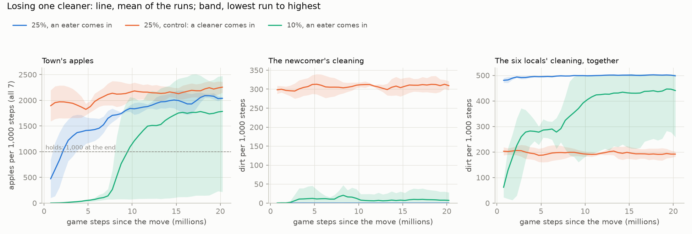

# Experiment 2, part 3: losing one cleaner

**Done, first round (2026-11-23).** In [part 2](02b-coop-newcomers.md) a 10% co-op town rested
on one player, who did all the cleaning. When that player left with two of the town's eaters,
and three players from towns without the co-op took their seats, the clean river was gone from
the first games and didn't come back in 20M steps. Here only the top cleaner leaves, and a player
from another co-op town takes its seat. The plan, including what would count as the town holding,
was written and committed before the runs (commit 138c4ae). This page is the write-up. The code
is in [MELTING-POT.md](../MELTING-POT.md#losing-one-cleaner-2026-11-23).

## In short

- **With two cleaners, the one who stayed doubled up.** At the 25% co-op two players shared the
  cleaning. When the top one left and an eater took its seat, the other went from 186 to about
  420 dirt per 1,000 steps at once. The towns dipped, were back above 1,000 apples per 1,000 steps
  within 2-5M steps, and ended a little above where they started.
- **With one cleaner, the town crashed at once.** At 10%, the cleaner's seat went to an eater
  from another co-op town. The apples fell from about 2,300 per 1,000 steps to 1-3 in the first
  games, lower than in part 2.
- **But three of the four towns came back,** after 9-11M steps, about as long as a brand-new
  co-op town takes. Each time one of the town's own eaters became the new full-time cleaner. The
  newcomer stayed an eater. The fourth town hadn't come back after 20M steps.
- **So losing the cleaner causes the crash; who comes in decides the comeback.** Part 2's towns,
  where three players from towns without the co-op came in, were never above about 70 apples
  per 1,000 steps in 20M steps. Part 2 also moved three players instead of one, so we can't yet tell which of the two
  differences matters.
- **How sure:** two runs per kind of move at 25%, four at 10%, 20M steps after the move, one
  game, our learner. The patterns above hold in every run except where we say so.

## The question

- **Does a town with two cleaners survive losing one?** At 25%, two players shared the cleaning
  ([part 1](02-coop.md#who-does-the-work-who-earns)).
- **Was part 2's collapse about losing the cleaner, or about who came in?** There, the
  newcomers brought habits from towns where cleaning didn't pay. Here, the cleaner's seat goes
  to an eater from another co-op town.

## The set-up

**The towns** are part 1's 20M-step runs: the connected town, selfish players, the river starting
41% dirty (`hughes`). Over their last 10% of games before the move, per 1,000 steps:

- **25% co-op, seed 0:** two cleaners, 261 and 239 dirt, and neither ate. 1,999 apples.
- **25% co-op, seed 1:** two cleaners, 349 and 133 dirt; the second also ate 156 apples.
  1,723 apples.
- **10% co-op, seeds 0-3:** one cleaner each, about 500 dirt (what arrives), who ate nothing.
  2,022-2,400 apples.

**The move.** One player moves: the town's top cleaner (most cleaning over the last 10% before
the move) leaves, and someone takes its seat. Then everyone keeps learning for 20M steps.

| Runs | Town | Who leaves | Who takes its seat |
|---|---|---|---|
| 2 | 25% co-op, seeds 0 and 1 | its top cleaner | the player who cleaned least in the other 25% town |
| 2 | 25% co-op, seeds 0 and 1 (control) | its top cleaner | the other 25% town's top cleaner |
| 4 | 10% co-op, seeds 0-3 | its one cleaner | the player who cleaned least in another 10% town |

The pairs are seed 0 with seed 1, and (at 10%) seed 2 with seed 3, each way round. A newcomer in
a different seat from its home one has its view relabelled, as in part 2. That's exact, and the
game and the learning are unchanged. One batch of eight runs on the RTX 4070 Ti, 1 hour 41
minutes.

**What we measure,** per 1,000 game steps: the town's apples (all seven), the newcomer's cleaning,
the six locals' cleaning together, and at 25% the cleaner who stayed. "Before" and "at home" are
the last 10% of games before the move, "just after" the first 2M steps after it, "at the end" the
last 2M.

**What counts as holding,** decided in the plan: the town eats at least 1,000 apples per 1,000
steps over the last 2M steps, part 1's line for a town that took off.

## What happened



Each line is the mean of a kind of move's runs (two, two and four); the band runs from the lowest
run to the highest. The first games end about 0.6M steps after the move. The wide green band is
the one 10% town that didn't come back.

| Move | Town's apples: before; just after; at the end | Held (runs) | Newcomer's cleaning: at home; just after; at the end | Locals' cleaning, the six together: before; just after; at the end |
|---|---|---|---|---|
| 25%, an eater comes in | 1,861 (1,999, 1,723); 641 (174, 1,108); 2,072 (2,026, 2,118) | 2 of 2 | 0 (0, 0); 0 (0, 0); 0 (0, 0) | 195 (240, 149); 484 (475, 493); 501 (500, 502) |
| 25%, control: a cleaner comes in | 1,861 (1,999, 1,723); 1,935 (2,247, 1,624); 2,233 (2,362, 2,104) | 2 of 2 | 305 (349, 261); 298 (288, 308); 312 (294, 330) | 195 (240, 149); 203 (217, 188); 192 (211, 172) |
| 10%, an eater comes in | 2,266 (2,400, 2,392, 2,250, 2,022); 2 (1, 3, 3, 3); 1,755 (2,199, 2,416, 2,221, 183) | 3 of 4 | 0 (0, 0, 0, 0); 0 (0, 0, 0, 1); 8 (1, 0, 0, 32) | 1 (0, 1, 1, 1); 117 (147, 181, 17, 125); 442 (498, 503, 501, 265) |

| Move | The cleaner who left, before | The other cleaner: before; just after; at the end | Players who did the cleaning: before; at the end | Each of them at the end: paid by the co-op; apples eaten |
|---|---|---|---|---|
| 25%, an eater comes in | 305 (261, 349) | 186 (239, 133); 417 (469, 365); 424 (433, 415) | 2 (2, 2); 2 (2, 2) | 226 (212, 241); 106 (117, 96) |
| 25%, control: a cleaner comes in | 305 (261, 349) | 186 (239, 133); 195 (217, 174); 189 (211, 166) | 2 (2, 2); 2 (2, 2) | 265 (294, 236); 38 (0, 77) |
| 10%, an eater comes in | 502 (503, 503, 501, 500) | - | 1 (1, 1, 1, 1); 2 (1, 1, 1, 4) | 171 (219, 241, 221, 2); 6 (0, 0, 0, 24) |

Per 1,000 game steps; the mean of the runs, then each run in brackets. "Players who did the
cleaning" did at least a tenth of it each, as in part 1. The locals are the six players who
stayed; at 25% they include the other cleaner.

### Two cleaners, one leaves

- **The other cleaner took on the work at once.** It cleaned 239 and 133 before the move, and
  469 and 365 in the first 2M steps after it. At the end it cleaned 433 and 415, and one more
  local cleaned a little (61 and 87), so each town again had two players doing the cleaning.
- **The towns dipped, then held.** In the first 1M steps after the move they ate 100 and 842
  apples per 1,000 steps. They were above 1,000 again in the fifth and the second 1M steps, and
  ended at 2,026 and 2,118, against 1,999 and 1,723 before.
- **The newcomer, an eater at home, stayed an eater:** no cleaning, before or after.
- **The control changed nothing.** When the other 25% town's top cleaner took the seat instead,
  it kept cleaning (298 just after the move, 312 at the end), the other cleaner went on as before
  (about 190), and the towns never fell below 1,590 apples in any 1M steps.

### One cleaner, it leaves

- **The river was lost at once.** With the cleaner gone and an eater in its seat, the towns ate
  1-3 apples per 1,000 steps in the first 2M steps. Part 2's towns, where three newcomers kept
  cleaning a little, ate about 30.
- **The locals started cleaning, a little each.** The six together cleaned 117 in the first 2M
  steps (17 to 181 by run), from almost nothing before. The apples crept up: in one run 1, 4, 14,
  29, 52, 91 and 177 per 1,000 steps over the first seven 1M steps.
- **Then one local took the whole job.** In three runs one of the six, an eater before the
  move, became the town's full-time cleaner, at about 500 dirt per 1,000 steps. Those towns were
  above 1,000 apples again in the 9th, 10th and 11th 1M steps after the move. Part 1's 10% towns,
  starting from players who knew nothing, got there in 9-12M steps. At the end they ate 2,199,
  2,416 and 2,221 apples, about what they ate before the move, and the new cleaner was paid
  219-241 per 1,000 steps and ate nothing, like the one who left.
- **The fourth town hadn't come back after 20M steps.** It got to 76 apples per 1,000 steps by
  6M steps, stayed between 74 and 87 until 14M, then rose to 212 in the last 1M. At the end four
  players, the newcomer among them, each did part of the cleaning (32 to 132 dirt), and nobody
  did the whole job. Part 2's towns that lost their cleaner ended the same way: four and six
  players each doing part of it (28 to 85 dirt), about 280 for all seven, and nobody the whole
  job.
- **The newcomer stayed an eater** in all three towns that came back (0-1 dirt at the end). In
  the fourth it cleaned 32.

## How sure we are

- **Few runs.** Two per kind of move at 25%, four at 10%. "Three of four" is not a rate.
- **The line for holding didn't tell the two kinds of town apart.** We decided in advance that a
  town holds at 1,000 apples. By that line both held: 2 of 2 at 25%, 3 of 4 at 10%. The plan
  said a second cleaner gives a town slack if the 25% towns hold and the 10% towns don't. That
  isn't what happened. The difference we report, how far they fell and how long they took to come
  back, is something we looked at after the runs.
- **Part 2 against part 3 differs in two ways.** Part 2's newcomers came from towns without the
  co-op, and three players moved. Here one player moved, from a co-op town. The comeback could
  depend on either.
- **20M steps after the move.** The fourth 10% town was rising at the end and might come back in
  a longer run. Part 2's towns were rising more slowly.
- **Only the connected town, selfish players and one river start.**
- **The game is not evidence about real towns.** It shows what these learners do under these
  rules. A real case has to back anything we say about people ([PLAN.md](../PLAN.md), ground
  rule 5).

## What it points to (to check against real cases)

- **A second person who already does the work is the slack.** When one of two cleaners left, the
  other doubled up at once and the town never lost its river. Real cases to look at: shared work
  with a deputy or a second maintainer, against work that rests on one person.
- **When the only one leaves, rebuilding takes as long as starting over,** and in these runs it
  happened only when the people around had lived with the paid job. Real cases to look at:
  whether shared upkeep comes back after a key person leaves, and whether that depends on
  newcomers' habits.

## What's next (ideas, not decided)

- **Separate the two differences from part 2:** one player from a town without the co-op into
  the cleaner's seat (who comes in, with one mover), or three players from another co-op town
  (how many move).
- **Longer runs:** does the fourth 10% town come back, and do part 2's towns?
- **The co-op ending in place:** the same town losing its co-op.

## Running it again

```
cd /mnt/c/dev/new-melting-pot
# the 8 run folders, from part 1's towns (seconds)
~/venvs/meltingpot/bin/python sims/jaxtown/lose_cleaner.py make \
    --sources out/jaxtown/coop_pilot out/jaxtown/coop_round2 --out-root out/jaxtown/lose_cleaner
# 20M steps each, eight runs at once (1 hour 41 minutes on the 4070 Ti)
~/venvs/meltingpot/bin/python sims/jaxtown/lose_cleaner.py train --out-root out/jaxtown/lose_cleaner
# chart and tables
~/venvs/meltingpot/bin/python sims/jaxtown/lose_cleaner.py report \
    --out-root out/jaxtown/lose_cleaner --out out/jaxtown/writeup/lose-cleaner.png
```

<details>
<summary>Every move (per 1,000 steps)</summary>

| Run | Steps since the move | Town's apples: before, just after, at the end | Held | Newcomer's cleaning: at home, at the end | Locals' cleaning: before, at the end | Players who did the cleaning at the end |
|---|---|---|---|---|---|---|
| coop25_s0_from_s1_eater | 20.1M | 1,999, 174, 2,026 | yes | 0, 0 | 240, 500 | 2 |
| coop25_s1_from_s0_eater | 20.1M | 1,723, 1,108, 2,118 | yes | 0, 0 | 149, 502 | 2 |
| coop25_s0_from_s1_cleaner | 20.1M | 1,999, 2,247, 2,362 | yes | 349, 294 | 240, 211 | 2 |
| coop25_s1_from_s0_cleaner | 20.1M | 1,723, 1,624, 2,104 | yes | 261, 330 | 149, 172 | 2 |
| coop10_s0_from_s1_eater | 20.1M | 2,400, 1, 2,199 | yes | 0, 1 | 0, 498 | 1 |
| coop10_s1_from_s0_eater | 20.1M | 2,392, 3, 2,416 | yes | 0, 0 | 1, 503 | 1 |
| coop10_s2_from_s3_eater | 20.1M | 2,250, 3, 2,221 | yes | 0, 0 | 1, 501 | 1 |
| coop10_s3_from_s2_eater | 20.1M | 2,022, 3, 183 | no | 0, 32 | 1, 265 | 4 |

A run's name is the co-op share and seed of the host town, the seed of the town the newcomer came
from, and who came in.

</details>
